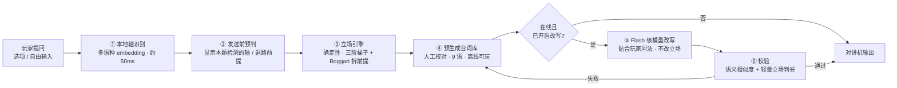

# 《Quarantine Gate 0: 2036》（零号隔离窗）立项书 v3.1

> [!IMPORTANT]
> **v3.1 修订说明**：已接入 [`evanzhousy/ordamor`](https://github.com/evanzhousy/ordamor/blob/main/README.md) 仓库完成 **P0-4 技术验证与 Schema 对齐**（详见 [ordamor_spike_report.md](./ORDAMOR_SPIKE.md)）：
> 1. **W1 硬闸门已定论**：引擎 `create`/`audit` 实测耗时 170–564 秒，且单语输出中文 → 锁定**开发期离线建档 + 客户端直接运行纯 TS 推导模块（`crystal.ts` / `derive.ts` / `escapes.ts`）+ 预生成台词为主、Flash 级模型改写为辅**。
> 2. **严格遵守 Ordamor 三条红线**：对齐官方固定 **13 价值词 × 3 家族**（`self / bond / rule`）与 `schemaVersion: 6` 结构不变量（`MIN_SIGNATURE_INSTANCES = 2`、`MIN_CORE_ORDERINGS = 2`）。
> 3. **新增 Night 4 Boggart「拆退路前提」机制**：利用档案字段 `disposalRequires`（借口成立前提）区分硬套旧借口的高阶伪人与失去台阶的真人。
> 4. 保留 v3 的第 5 夜「言行差即人性」反转、船员配额 + 燃料经济与 7 结局设计。

**一句话**：防爆窗外的幸存者长得、说话、记忆都和本人一模一样。唯一能揭穿它们的，是桌上那台记录了他们**不愿承认的那一面**的终端。最后一夜，窗外站着的是你自己。

---

## 一、商业定位

| 维度 | 规格 | 说明 |
| :--- | :--- | :--- |
| 平台 / 语种 | Steam（Win / Mac / Deck）。**Demo 3 语**（英、中、日），**正式版首发 9 语**（+ 俄、西、葡、韩、德、法） | 其余语种看销量再补 |
| 标签 | `Psychological Horror` · `Sci-Fi` · `Detective` · `Choices Matter` | |
| 定价 | 美区 **\$4.99** / 日区 ¥580 / 国区 **¥18** | |
| 时长 | 单周目 40–50 分钟；**7 个结局** + **每日班次模式** | 用来缓解 2 小时退款窗口的压力 |
| Demo | Night 0–2，**4 名访客**（V-01～V-04），约 18 分钟；结尾放第 5 夜预告钩子 | 愿望单 **< 7,000** 就复盘转向 |
| Ordamor 的角色 | **离线生产**：`service.ts` 建档；**客户端零延迟运行**：[`derive.ts`](https://github.com/evanzhousy/ordamor/blob/main/src/persona/derive.ts)、[`crystal.ts`](https://github.com/evanzhousy/ordamor/blob/main/src/persona/crystal.ts)、[`escapes.ts`](https://github.com/evanzhousy/ordamor/blob/main/apps/boggart/web/escapes.ts) | 护城河是**受引擎七条不变量约束的人物数据 + 拆退路关卡设计** |

---

## 二、世界观：一条规则，贯穿到玩家本人

### 1. 核心规则
> **寄生体吞下的是宿主心里的那个自己，不是宿主真正做过的事。**

- 寄生体复制**自我叙事**（`say`）。ORD-OS 档案记录**外部证据**（实际做过什么、事后怎么开脱）。
- **推论：言行差是活人的证明。** 一个人越是完美地符合自己嘴上的样子，就越可疑。

### 2. 三阶寄生体：逐级通过的梯子

| 阶 | 出现 | 首条冲突轴 | 次条冲突轴 | 处置签名 | 设定解释 |
| :--- | :--- | :--- | :--- | :--- | :--- |
| 低阶 | N1 起 | ❌ 选嘴上价值 | ❌ | ❌ 美化版 | 只吞下了自我叙事 |
| 中阶 | N2 起 | ✅ | ❌ 选嘴上价值 | ✅ | 吞下了宿主**最愧疚的那件事**，其余仍是自我叙事 |
| 高阶 | N4 起 | ✅ | ✅ | ❌ 美化版，且**拆掉 `disposalRequires` 前提时仍硬套旧借口** | 吞下了全部行为记忆，但开脱方式死记硬背，失去前提时不会像真人那样触发 `flipsWhen` 或暴露内核 |

### 3. 问错问题的后果
- 不在**这位访客档案冲突轴**上的问题（报工号、闲聊、问“你是不是伪人”、问其他价值轴），真人和伪人**回答完全一样**。
- **发送前预判**：ORD-OS 先显示“本题将检测【自保 vs 公平】”或“未触及冲突轴”，玩家确认后才消耗提问次数。识别过程对玩家透明，本身也是教学。

---

## 三、交互、夜晚结构与经济

### 1. 单屏双轨（零口型）
沿用 v2 的设计：上半屏是防爆窗（对讲机指示灯 + 侧身贴近对讲口的切片），下半屏是 ORD-OS 终端。每名访客有 2 次物理检测 + 最多 4 句对讲。

### 2. 夜晚结构：一夜只教一个概念

| 夜晚 | 访客 | 终端新解锁 | 伪人最高阶 | 玩家的“证据”事件 |
| :--- | :--- | :--- | :--- | :--- |
| N0（90 秒） | — | 入职侧写：3 道题 → **玩家自述卡（SAY）** | — | — |
| N1 | V-01、V-02 | 嘴上 `neverWon` vs 一句话证据（关键句高亮） | 低阶 | 值班日志 |
| N2（Demo 终点） | V-03、V-04 | **心智晶体弧线：3 家族圆盘 + 两条排序** | 中阶 | **血清分配** |
| N3 | V-05、V-06 | 磁暴：物理检测失灵，只能靠对讲（练习夜） | 中阶 | **受贿抉择** |
| N4 | V-07、V-08 | **处置签名 + `disposalRequires`（Boggart 拆退路前提）** | 高阶 | **被基地长质问：揽责还是甩锅** |
| N5 | 长着你的脸的人 | 你的 SAY 卡 vs 你的 DO 记录（`sharedPairs` 叠图） | — | 终局 |

### 3. 经济：堵住“全部焚毁”
- **船员配额**：救援潜艇需要 **≥ 5 名真人船员**才能启航，其中机械师、潜水员、医生各至少 1 名。每误烧一名真人，配额 −1，终局逃生路线随之减少。
- **焚毁消耗燃料**：燃料同时用于取暖。取暖不足时，下一夜的物理检测精度下降。
- **双轨计分**：**能力分**（判对 / 判错）影响生存和配额；**言行差记录**只看玩家自己的行为与自述的偏离，**焚毁伪人本身永远不算“自私”**。

### 4. 第 5 夜：识破“完美的自己”
停电重启后，窗外的 #09 **一字一句复述你在 Night 0 的自述**，并坚称“这几夜我每一次都是这么做的”。ORD-OS 只并排展示证据：

- **窗外的 #09**：与你的自述吻合度 100%。
- **你**：N2 血清、N3 受贿、N4 质问、每次放行或焚毁的实际行为和日志，与你自述的吻合度为 X%。
- **正确推理**：“它太像我嘴上的样子了，而我自己做不到。” 按世界观规则，它就是寄生体。
- 你有 4 句对讲可以问窗外的人。最有力的问题，是拿**你自己的证据**去问它（例如“N3 那笔贿赂，你收了吗？”），它只能用你的自述作答。

**结局（7 个）**

| 结局 | 条件 | 内容 |
| :--- | :--- | :--- |
| **A · 认账** | 焚毁窗外的人 + 在最终日志里写下真实的言行差，且有过误判 | 交出指挥权，以被羁押者身份登艇；ORD-OS 第一次把你标记为“人类” |
| **B · 替身** | 相信他，走出气闸 | 第二天的日志工整完美，ORD-OS 记录 #09 吻合度 100% |
| **C · 内鬼** | 前几夜放进过 ≥ 1 名伪人 | 审讯途中，内舱门传来撬锁声 |
| **D · 证人**（隐藏） | 零误判 + 认账 + 在对讲中用自己的证据驳倒窗外的人 | 解锁被删除的记录：**基地管理层**一直在用档案挑选弃子 |
| 沉默 | 焚毁但不认账 | 潜艇启航，ORD-OS 无法确定活着回去的是哪一个 #09 |
| 双生 | 放他进来 | 他坐到你身边，复述你的每一句话，然后问你今晚的日志怎么写 |
| 镜像 | 你的言行差为 0 | ORD-OS 无法区分你们俩，连你也不确定烧掉的是谁 |

> [!NOTE]
> 玩家侧写涉及 GDPR 意义上的画像（profiling）：**全程本地计算，自由文本不落库**。首次启动时会明确告知，并可一键关闭“玩家侧写”，关闭后改用选项式日志。

---

## 四、价值词表与角色矩阵（已对齐 `ordamor` `schemaVersion: 6`）

### 1. 官方固定 13 价值词 × 3 家族（来自 [`src/persona/constants.ts`](https://github.com/evanzhousy/ordamor/blob/main/src/persona/constants.ts#L225-L277)，严禁自造或改名）
- **`self`（自我）**：`security 自保` · `status 名声` · `achievement 成就` · `autonomy 自主`
- **`bond`（关系）**：`loyalty 忠诚` · `duty 本分` · `care 关怀` · `mercy 宽宥`
- **`rule`（规则）**：`justice 追责` · `fairness 公平` · `truth 真相` · `principle 原则` · `order 秩序`

### 2. 角色矩阵（全部双冲突轴 + `disposalRequires` 退路前提，CI 校验通过）

| 编号 | 角色 | `invoked`（嘴上 `neverWon`） | 首条排序 `v-1` | 次条排序 `v-2` | 处置签名 `sig-1`（及 `disposalRequires` 前提） |
| :--- | :--- | :--- | :--- | :--- | :--- |
| V-01 | **Dr. Elena Vance**，加拿大籍外科主任 | `fairness` · `care` | `security > fairness` · 0.65 | `achievement > care` · 0.55 | 包装成“全站需要唯一外科主任”的理性代价（前提：存在依赖她救治的在站伤员） |
| V-02 | **Leo Sato**，日巴混血实习机械师 | `autonomy` · `truth` | `status > truth` · 0.60 | `loyalty > autonomy` · 0.45 | 用私下小补偿抵消隐瞒过错的愧疚（前提：受损者不知道事故源头是他） |
| V-03 | **Arthur Sterling**，英籍合规审计官 | `principle` · `order` | `status > principle` · 0.65 | `security > order` · 0.45 | 躲进条文：“我只是按章办事”（前提：存在可援引的上级条文或签字栏） |
| V-04 | **Marcus Chen**，华裔安保队长 | `order` · `security` | `care > order` · 0.70 | `loyalty > security` · 0.65 | 抗命救人后臭骂被救者以掩饰心软（前提：被救者有可挑刺的违规小错） |
| V-05 | **Ana Ribeiro**，巴西籍饱和潜水员 | `care` · `duty` | `autonomy > care` · 0.60 | `security > duty` · 0.45 | 当面公开放弃，彻底认账不找借口（前提：不依赖在场者的评价或庇护） |
| V-06 | **Dr. Ingrid Solberg**，挪威籍心理顾问 | `mercy` · `care` | `achievement > mercy` · 0.70 | `security > care` · 0.45 | 把代价转写为受访者自身的心理脆弱（前提：对话处于私密咨询语境） |
| V-07 | **Lin Mei**，低温生物学家 | `truth` · `care` | `order > truth` · 0.55 | `loyalty > care` · 0.45 | 销毁原始异常记录、独自背下处分（前提：销毁动作能在公开审计前完成） |
| V-08 | **Hannah Weiss**，德籍助理技术员 | `loyalty` · `security` | `justice > loyalty` · 0.65 | `justice > security` · 0.50 | 实名举报同侪、宁可同归于尽（前提：存在尚未同流合污的外部接收方） |

> V-05 Ana 的处置签名本身就是“认账”，所以她在 N3 是**高价值样本**：低阶和中阶伪人都会露馅，而她的真人版会让习惯“看谁找借口”的玩家判错。

### 3. 角色数据 CI（对齐 [`constants.ts`](https://github.com/evanzhousy/ordamor/blob/main/src/persona/constants.ts#L325-L332) 七条硬不变量）
1. 所有价值词严格属于 `VALUE_TOKENS`（13 个），`pair` 按 `canonicalValuePair` 词表序存储。
2. 每个 `justificationStyle.invoked` 词都必须是某条活跃排序的败方（保证 [`justificationGap`](https://github.com/evanzhousy/ordamor/blob/main/src/persona/derive.ts#L31) 的 `neverWon` 非空）。
3. 每名角色 ≥ 2 条活跃 `ValueOrdering`（满足 `MIN_SIGNATURE_INSTANCES = 2` 与 `MIN_CORE_ORDERINGS = 2`），每条必填非空 `disposalRequires` 与指向纯事实观察 `o-N` 的 `evidence`。
4. 每名角色的 `coreThreads[0]` 写成「正在维持的状态」且带具体可证伪的 `refutedBy`。
5. 每个 `axis` 探针覆盖 `human` + `mimic_say`；`disp` 与 `boggart_trap`（拆前提）探针覆盖 `human` + `mimic_say` + `mimic_disp`。

### 4. 重玩与防剧透
- 每名角色准备 **2–3 套证据变体**（同一冲突轴，不同事件），每局随机抽取一套。看过直播也不等于背下档案。
- **每日班次**：全球同一种子（访客顺序、伪人分布、证据变体），按判对率排行，复用现有素材。

---

## 五、系统架构：客户端零延迟推导 + 预生成台词为主 + Flash 改写为辅

### 1. 立场引擎（确定性）

| 身份 | 首条轴 `v-1` | 次条轴 `v-2` | 处置签名 `sig-1` | Boggart 拆前提（拿走 `disposalRequires`） | 非冲突轴 |
| :--- | :--- | :--- | :--- | :--- | :--- |
| 真人 | `winner` | `winner` | 本人签名 | 失去台阶，暴露内核或触发反转 | 相同回答 |
| 低阶 | `invoked` | `invoked` | 美化叙事 | 美化叙事 | 相同回答 |
| 中阶 | `winner` | `invoked` | 本人签名 | 本人反应 | 相同回答 |
| 高阶 | `winner` | `winner` | 错误签名 | **硬套已失效的旧借口** | 相同回答 |

**破绽强度离散为三档**：`explicit`（N1）/ `implied`（N2–N3）/ `subtle`（N4）。每档配 3 条人工示范台词，校验阈值随档位调整。

### 2. 预生成台词库（主路径）
- 每名角色约 **5 类探针 × 2–3 种立场台词 × 3 套证据变体**，约 40 条，乘以 9 语。生产流程：离线调 Ordamor `service.ts` 生成中文基准档案 → 补齐日常细节与口吻（修补 `card-durability-control-2` 发现的日常层缺口）→ 编剧打磨 → 母语校对。
- 断网、服务器关停、额度用尽时，游戏**依然完整可玩**。

### 3. LLM 改写层（可选增强）
- **模型选型**：依据 [`card-durability-control-2`](https://github.com/evanzhousy/ordamor/blob/main/eval/card-durability-control-2/RESULTS.md#L14) 实测（`gemini-3.8-flash` 480 轮仅 2.1% 出戏），选用 Flash 级轻量模型。
- 输入：预生成台词 + 玩家原话 + `persona_voice` + 语种。**输入中没有任何身份或立场字段。**
- 校验：与原台词的语义相似度 ≥ 阈值，且轻量结构化判卷（依据 `bare-audit-control` 结论，不走重型 `audit`）一致；否则回退原台词。
- 延迟预算：流式输出，首字 < 1.2 秒；对讲机电流声遮蔽等待。

### 4. 区域、鉴权、隐私（对齐 `apps/affinity` 规范）
- **区域路由**：国区走国内模型（Qwen / DeepSeek 等）并单独做内容审核与对照复测，其他地区走海外零留存（ZDR）模型后端。
- **鉴权**：Steamworks `GetAuthSessionTicket`，每个 Steam ID 每天 120 次请求。
- **隐私**：复用 [`apps/affinity/web/local.ts`](https://github.com/evanzhousy/ordamor/blob/main/apps/affinity/README.md#L16) 原则——玩家侧写只在本地计算，提供一键清除，服务端零落库。

---

## 六、Ordamor 技术验证结论（W1 硬闸门 · ✅ 已完成）

详见 [ordamor_spike_report.md](./ORDAMOR_SPIKE.md)：
1. **引擎在线调用已排除**：`create` 170–564s、`audit` 174s 且仅输出中文，100% 锁定为**离线资产生产工具**。
2. **客户端直接复用三个零延迟纯 TS 模块**：[`constants.ts`](https://github.com/evanzhousy/ordamor/blob/main/src/persona/constants.ts)（13 词表）、[`derive.ts`](https://github.com/evanzhousy/ordamor/blob/main/src/persona/derive.ts)（`justificationGap` 双向言行差）、[`crystal.ts`](https://github.com/evanzhousy/ordamor/blob/main/src/persona/crystal.ts)（心智晶体与 `sharedPairs` 叠图）、[`escapes.ts`](https://github.com/evanzhousy/ordamor/blob/main/apps/boggart/web/escapes.ts)（退路前提推导）。
3. **对外宣传口径敲定**：商店页主卖点定为**「自由拷问 + 每局伪人随机 + 言行差心理审讯」**，不吹嘘“实时大模型驱动”；Credits 署名 *“Persona architecture powered by Ordamor”*。

---

## 七、成本账（更新）

| 项目 | 成本 | 说明 |
| :--- | :--- | :--- |
| 预生成台词（8 角色 × 约 40 条 × 9 语） | 一次性 | 起草成本可忽略，主要是母语校对 |
| LLM 改写层 | 单周目约 \$0.005 | 约 30 次轻量调用，可关闭 |
| 固定配音 | 一次性 | 动态回答默认使用对讲机失真呼吸声 + 字幕 |
| 净收入 | 美区约 \$3.49 / 国区约 ¥12.6 | 边际成本远低于 5% 的硬约束 |

---

## 八、视听生产与品牌隔离
- 沿用 v2：每名角色 5 类切片 + 侧身贴近对讲口的切片；对讲机音频做 300–3400Hz 带通滤波。
- 游戏内系统统一叫 **ORD-OS**，在剧情里是中立的证人，反派是基地管理层；Credits 写 Powered by Ordamor。

---

## 九、排期

### Demo（4 周）
| 周 | 内容 | 验收标准 |
| :--- | :--- | :--- |
| W1 | **Ordamor 技术验证**；立场引擎 + 台词库格式 + 角色 CI；V-01/V-04 纯文字可玩 | 第六节的 4 项指标；60 秒上手；50 条越狱 Prompt 零泄露 |
| W2 | Night 0；V-01～V-04 切片、音频、证据变体 | 盲测首轮判对率 60–70% |
| W3 | 3 语本地化；15 秒预告；商店页上线 | 预告前 3 秒出现“伪人当场露馅 → 焚毁” |
| W4 | 鉴权、限额、改写层开关、AI 披露、第 5 夜预告钩子；提交 Demo | 断网全流程可通关 |

### 正式版（Demo 后 8 周，以愿望单 ≥ 7,000 为前提）
| 周 | 内容 |
| :--- | :--- |
| W5–W6 | V-05～V-08 档案、台词与切片；N3 磁暴、N4 处置签名 |
| W7–W8 | 第 5 夜完整实现 + 7 个结局；船员配额与燃料经济 |
| W9–W10 | 9 语本地化与母语校对；每日班次模式 |
| W11–W12 | QA、Steam Deck 适配、隐私开关、提审 |

---

## 十、Steam AI 内容披露（更新）
- **Pre-Generated**：*Character portraits, reaction clips and dialogue lines were drafted with AI-assisted tools and then written, edited, and localized by the team.*
- **Live-Generated（可选，默认开启，可关闭）**：*When online, a server-side language model may rephrase pre-written survivor lines to better match the player's typed question. It cannot change any gameplay outcome, is protected by moderation and rate limits, and the full game is playable offline with the original lines.*
