# Google Colab Remote MCP & Google Drive Experience Playbook

This guide documents how we connected Antigravity to **Google's managed Colab Remote MCP** (`https://colaboratory.googleapis.com/mcp`) via an auto-refreshing local Stdio-to-Streamable-HTTP bridge, and the practical lessons learned operating **Google Drive (`gdrive` CLI plugin + idempotent sync scripts)** across Colab, Google AI Studio, Google Flow, and local builds.

---

## Architecture Overview

```mermaid
flowchart LR
    Agent["Antigravity Agent / IDE<br/>(MCP Stdio Client)"]
    Bridge["Local Stdio Bridge<br/>colab_remote_mcp_bridge.py<br/>(gcloud ADC auto-refresh)"]
    ColabMCP["Google Colab Remote MCP<br/>https://colaboratory.googleapis.com/mcp<br/>(Streamable HTTP + Mcp-Session-Id)"]
    Runtime["Managed Colab Runtime<br/>(T4 / L4 / A100 Jupyter Server)"]
    Drive["Google Drive (20 TB Workspace)<br/>public@tfsharedspace.com"]
    GDriveCLI["gdrive Plugin CLI<br/>(AGY_ACCOUNT pinned)"]
    Repo["Local Repository<br/>public/videos · videos/gate0-trailer"]

    Agent <-->|"JSON-RPC 2.0 (Stdio)"| Bridge
    Bridge <-->|"HTTPS + Bearer ADC + x-goog-user-project"| ColabMCP
    ColabMCP <--> Runtime
    Runtime <-->|"drive.mount('/content/drive') / HTTP Proxy"| Drive
    Drive <-->|"readonly ls/download · mutate upload/update"| GDriveCLI
    GDriveCLI <-->|"pull-gdrive-videos.ts / push-gdrive-assets.ts"| Repo
```



---

## Part 1: Connecting to Google Colab via Remote MCP

### 1.1 Why a Local Auto-Refreshing Stdio Bridge Instead of Static Headers or Generic `mcp-remote`

Google's official managed Colab Remote MCP endpoint lives at:

```text
https://colaboratory.googleapis.com/mcp
```

In practice, pointing an IDE directly at that URL with a static `Authorization: Bearer ...` header (or a generic `mcp-remote` wrapper without Google ADC awareness) hits **four recurring failure modes**:

1. **60-Minute OAuth Token Expiry**: Google OAuth2 access tokens expire every hour. A static Bearer header in `mcp_config.json` silently breaks mid-session with `HTTP 401`.
2. **Missing `colaboratory` OAuth Scope**: Default `gcloud auth print-access-token` tokens do not carry `https://www.googleapis.com/auth/colaboratory`, causing `insufficient authentication scopes` errors on Colab tool calls.
3. **Required Quota Project Header (`x-goog-user-project`)**: Requests against `colaboratory.googleapis.com` need `x-goog-user-project` attached on every HTTP call for GCP quota attribution.
4. **Non-Login-Shell `PATH` Inside IDE Agents**: When Antigravity spawns an MCP server subprocess, it often does not load interactive zsh/bash profiles (so Homebrew `/opt/homebrew/bin/gcloud` or a standalone `google-cloud-sdk/bin/gcloud` is missing from `PATH`).

#### How Our Bridge Solves All Four

We run a lightweight zero-dependency Python 3 Stdio ↔ Streamable HTTP bridge (`colab_remote_mcp_bridge.py`) that:

- **Prefers Application Default Credentials (ADC)**: Calls `gcloud auth application-default print-access-token`, caches the token for **45 minutes** (`2700s`), and automatically force-refreshes once if the remote endpoint responds `HTTP 401`.
- **Graceful Bootstrapping Fallback**: If ADC is not logged in yet, falls back to `gcloud auth print-access-token` (rechecking ADC every **15 seconds**) so MCP `initialize` and `tools/list` still load cleanly—and if a tool call fails with `insufficient authentication scopes`, appends the exact one-line `gcloud auth application-default login` fix directly into the tool error payload.
- **Speaks MCP Streamable HTTP Properly**:
  - Sends `Accept: application/json, text/event-stream` and `x-goog-user-project: <COLAB_MCP_PROJECT>`.
  - Persists the server-issued `Mcp-Session-Id` header across calls.
  - Handles `HTTP 202` empty responses for JSON-RPC notifications, standard JSON responses, and `text/event-stream` (`data:` SSE lines).
  - Answers `ping` locally without an unnecessary network roundtrip.
- **Explicit `gcloud` Binary Discovery**: Checks `shutil.which("gcloud")`, `COLAB_MCP_GCLOUD_BIN`, standalone `google-cloud-sdk/bin/gcloud`, `/opt/homebrew/bin/gcloud`, and `/usr/local/bin/gcloud`.

---

### 1.2 Step-by-Step Setup

#### Step 1 — Grant ADC with the Official `colaboratory` Scope (One-Time)

Run once in your terminal using the Google account tied to your Colab / Colab Pro subscription:

```bash
gcloud auth application-default login \
  --scopes=openid,https://www.googleapis.com/auth/cloud-platform,https://www.googleapis.com/auth/userinfo.email,https://www.googleapis.com/auth/colaboratory
```

Set your quota project if not already configured:

```bash
gcloud auth application-default set-quota-project <YOUR_GCP_PROJECT_ID>
```

Verify a token can be minted cleanly:

```bash
gcloud auth application-default print-access-token | head -c 20 && echo "..."
```

#### Step 2 — Register `google-colab` in Antigravity `mcp_config.json`

Configure the server entry in `~/.gemini/antigravity/mcp_config.json` (and mirror in `~/.gemini/config/mcp_config.json` if using shared CLI/IDE configs):

```json
{
  "mcpServers": {
    "google-colab": {
      "command": "/usr/bin/python3",
      "args": [
        "/path/to/colab_remote_mcp_bridge.py"
      ],
      "env": {
        "COLAB_MCP_PROJECT": "<YOUR_GCP_PROJECT_ID>",
        "COLAB_MCP_GCLOUD_BIN": "/opt/homebrew/bin/gcloud"
      }
    }
  }
}
```

> **Tip**: Always point `"command"` to an absolute Python path (`/usr/bin/python3`) and set `COLAB_MCP_GCLOUD_BIN` explicitly so the bridge never depends on shell `PATH` inheritance.

#### Step 3 — Verify MCP Tool Discovery

Once registered, Antigravity discovers all **10 official `google-colab` MCP tools** (lazy-loaded under `<appDataDir>/mcp/google-colab/*.json`):

| Tool | Purpose |
| :--- | :--- |
| `get_subscription` | Inspect Colab tier (`free`, `Pro`, `Pro+`) before selecting GPU specs. |
| `list_runtime_specs` | List available `(variant, accelerator, shape)` tuples and eligibility. |
| `list_runtimes` | Check for an existing warm runtime to reuse before spinning up a new one. |
| `create_runtime` | Provision a managed runtime (`T4`, `L4`, `A100`, CPU/TPU); pass a UUID4 `requestId` for idempotency. |
| `get_runtime` | Fetch runtime spec + fresh `connectionInfo` (`url`, `token`, `expireTime`). |
| `delete_runtime` | Permanently terminate the runtime and stop compute-unit (CCU) billing. |
| `list_sessions` | List active Jupyter kernel sessions on a runtime. |
| `create_session` | Open an isolated stateful Jupyter kernel session on a runtime. |
| `execute_code` | Execute Python in a session (`stdout`, `stderr`, last expression `result`, `executionError`). |
| `delete_session` | Close a session you opened (files on disk remain until `delete_runtime`). |

---

### 1.3 Operational Best Practices Learned on Colab MCP

1. **Always Reuse Runtimes, Isolate with Sessions**:
   - Call `list_runtimes` before `create_runtime`. Runtime allocation is slow and quota-limited; opening a fresh `create_session` on an existing warm GPU runtime is near-instant and isolates kernel variables cleanly.
   - Pass a fresh UUID4 `requestId` to `create_runtime`. If `DEADLINE_EXCEEDED` occurs during provisioning, repeating the **exact same call** waits on the in-flight creation instead of leaking a second billed GPU.
2. **Resumable Long-Running Jobs (`executionId`)**:
   - `execute_code` cuts off at **600 seconds** with `DEADLINE_EXCEEDED`, while the code keeps running in the kernel.
   - Always pass a UUID4 `executionId` alongside a `session` target for long GPU renders/training. On timeout or `UNAVAILABLE`, re-sending the identical `(session, executionId)` **reattaches** and collects the output instead of executing the job twice.
   - Calls to a single session serialize (parallel calls queue and time out). Use separate sessions for parallel tasks.
3. **Never Transfer Binaries Through `execute_code` (Use HTTP Proxy API Instead)**:
   - `execute_code` returns **text only** (no images/plots) and truncates large output (`outputTruncated`). Base64-printing large media bloats agent context.
   - Instead, call `get_runtime` to obtain `connectionInfo.url` and `connectionInfo.token`, then transfer files directly over HTTP with header `X-Colab-Runtime-Proxy-Token: <token>` (paths omit the leading `/`, e.g., `content/output.mp4` for `/content/output.mp4`):
     - **Download** (supports `Range`):
       ```bash
       curl -H "X-Colab-Runtime-Proxy-Token: $COLAB_TOKEN" \
         "$COLAB_URL/files/content/output.mp4" -o output.mp4
       ```
     - **Upload** (JSON via Jupyter Contents API; keep each request `< 50 MB`, or send `"chunk": 1, 2, ..., -1` on the final chunk):
       ```bash
       curl -X PUT "$COLAB_URL/api/contents/content/input.bin" \
         -H "X-Colab-Runtime-Proxy-Token: $COLAB_TOKEN" \
         -H "Content-Type: application/json" \
         -d '{"type":"file","format":"base64","content":"<BASE64>"}'
       ```
   - **Token Expiry Gotcha**: `connectionInfo.token` expires in ~1 hour (`connectionInfo.expireTime`). An expired or missing token returns **`HTTP 404`** (not `401`!). Call `get_runtime` to refresh the proxy token.
4. **Zero-Waste GPU Teardown**:
   - Always call `delete_runtime` (or unassign in a `finally:` block) as soon as outputs are synced to Drive or pulled locally, so idle L4/A100 runtimes never burn CCUs.
5. **Complementary One-Click Notebook Workflow**:
   - For interactive runs or zero-setup sharing, [`notebooks/gate0_ai_video_studio.ipynb`](../notebooks/gate0_ai_video_studio.ipynb) mirrors our pipeline in Colab UI: supports both **`Veo 3`** (`GEMINI_API_KEY` via Colab `Secrets`) and free **Colab `T4 GPU`** (`Lightricks/LTX-Video`), then mounts `/content/drive` in Cell 4 to copy every rendered `.mp4` into `MyDrive/quarantine-gate-0-videos/`.

---

## Part 2: Google Drive Experience (`gdrive` Plugin CLI & Sync Pipeline)

### 2.1 Plugin CLI Setup & Credential Boundary

Antigravity ships the `gdrive` plugin CLI under the plugin skill directory:

1. **Bootstrap Once**: Run `<skill-path>/scripts/gdrive --version` once per machine to install/register `gdrive` on the agent's `PATH`.
2. **Always Invoke Bare `gdrive` Afterward**: Never invoke the bootstrap script path for actual Drive calls—only bare `gdrive` receives Antigravity's managed OAuth2 session.
3. **Strict `readonly` vs `mutate` Namespace Separation**:
   - Read operations live under `gdrive readonly` (`ls`, `search`, `download`, `info`, `url`, `tree`, `count`).
   - Write operations live under `gdrive mutate` (`upload`, `update`, `mkdir`, `cp`, `mv`, `rename`).
   - Treat `mutate empty-trash` and moving files out of shared folders as high-risk one-way doors (moving a file out of a shared parent silently strips inherited access).

### 2.2 Multi-Account Pitfall: Always Pin `AGY_ACCOUNT`

One of our most important operational lessons was **account hygiene** when working across a personal Gmail account (15 GB storage) and a shared Google Workspace account (**`public@tfsharedspace.com`**, 20 TB storage + Google Flow ULTRA tier):

- Before any Drive batch, check connected accounts via `list_plugin_accounts`.
- **Always prefix CLI commands with `AGY_ACCOUNT=public@tfsharedspace.com`**:
  ```bash
  AGY_ACCOUNT=public@tfsharedspace.com gdrive readonly ls 1Jld4N9lhQO9HEp5hLRNuiZdmm26oMeLg
  AGY_ACCOUNT=public@tfsharedspace.com gdrive mutate upload renders/quarantine-gate-0-trailer-en.mp4 \
    --parent 1Jld4N9lhQO9HEp5hLRNuiZdmm26oMeLg
  ```
- **Hardcode the Safe Default Inside Scripts**: Both [`scripts/pull-gdrive-videos.ts`](../scripts/pull-gdrive-videos.ts) and [`scripts/push-gdrive-assets.ts`](../scripts/push-gdrive-assets.ts) explicitly default `AGY_ACCOUNT` to `public@tfsharedspace.com` inside `gdriveEnv()` so running `pnpm media:pull-drive` or `pnpm media:push-drive` never accidentally targets the wrong Drive account.

### 2.3 Canonical Drive Vault Layout (`Quarantine Gate 0`)

All project media lives in two root folders on `public@tfsharedspace.com`:

| Drive Folder | Folder ID | Contents & Sync Role |
| :--- | :--- | :--- |
| **`quarantine-gate-0-videos`** | `1sB2OSIXVflmYK2aJ4MkkKYMv_UeL2c9l` | Per-character subfolders (`elena/`, `leo/`, `arthur/`, `marcus/`, `ana/`, `ingrid/`, `linmei/`, `hannah/`, `operator09/`, `chamber/`) holding all 28 `1280×720` live-action `.mp4` streams. Mirrors `public/videos/` 1:1. |
| **`quarantine-gate-0-assets`** | `1Jld4N9lhQO9HEp5hLRNuiZdmm26oMeLg` | Master snapshots & deliverables: `quarantine-gate-0-full-assets.zip`, `media-manifest.json`, and rendered launch trailer `quarantine-gate-0-trailer-en.mp4` (`1LgJ2dh7Heq7v6ObWJ-oxHnrgzj90V5wl`). |

### 2.4 Idempotent Sync Patterns (Avoiding Duplicate Drive Files)

Google Drive allows multiple files with the **same name** inside the same folder. Naive repeated `gdrive mutate upload` calls quickly pollute folders with duplicates.

Our [`scripts/push-gdrive-assets.ts`](../scripts/push-gdrive-assets.ts) (`pnpm media:push-drive`) prevents duplicates via two patterns:

1. **Idempotent `ensureFolder(name, parentId)`**:
   - Searches with `gdrive readonly search --name-exact "<name>" --parent-id "<parentId>" --json` and filters `mimeType === "application/vnd.google-apps.folder"`.
   - Only runs `gdrive mutate mkdir` if zero matching folders exist, parsing the new `ID:` directly from CLI output.
2. **Idempotent `upsertFile(localFile, parentId, force)`**:
   - Lists existing folder children via `gdrive readonly ls <parentId> --max 200 --json`.
   - If a file with the same name already exists:
     - Compares `Number(existing.size) === localSize`. If identical (and `--force` is not set), **skips** upload (`0` wasted bandwidth).
     - If changed, runs **`gdrive mutate update <existing.id> <localFile>`** to replace content **in place**—preserving the original Drive File ID, URL, and sharing permissions.
   - Only calls `gdrive mutate upload <localFile> --parent <parentId>` for brand-new files.

For pulling Colab / Drive outputs back into the repo:

```bash
pnpm media:pull-drive                                   # auto-finds quarantine-gate-0-videos -> public/videos/
pnpm media:pull-drive 1sB2OSIXVflmYK2aJ4MkkKYMv_UeL2c9l # or pass explicit folder ID
```

### 2.5 Bridging Colab, AI Studio, Google Flow & Local Storage

Across game production and the 60s launch trailer, combining Drive with Colab / AI Studio / Flow established four durable habits:

1. **Persistent Model Cache on Drive (Colab)**: Store multi-GB HuggingFace / diffusion checkpoints in `MyDrive/<cache-dir>` so spinning up a fresh Colab `T4`/`L4` runtime does not re-download 10+ GB of weights every session.
2. **AI Studio Web Drive Permission Popup**: When rendering via Google AI Studio Playground in `ego-browser` under `public@tfsharedspace.com`, enabling AI Studio's `"Enable Google Drive"` OAuth popup lets AI Studio save assets inside the same Workspace account—while keeping `"No API key selected"` verified before every run guarantees **$0.00 paid Gemini API billing**.
3. **Keep Git Fast, Archive Heavy Masters to Drive**: Our local dev Mac had ~12 GiB free SSD during trailer production. We keep lightweight editable source in Git (`videos/gate0-trailer/compositions/*.html`, `index.html`, fonts, small UI PNGs) while `.gitignore` excludes `renders/`, `.hyperframes/`, and raw/conformed intermediate video & audio caches—archiving the final `61 MB` `1080p` master `.mp4` directly into `quarantine-gate-0-assets` on 20 TB Drive.
4. **Always Pass `--json` in Automation**: Human-formatted `gdrive` table output can truncate long filenames or change column widths. Every automation script (`pull-gdrive-videos.ts`, `push-gdrive-assets.ts`) passes `--json` and handles both array and `{ files / items }` payload shapes defensively.

---

## Part 3: Troubleshooting Quick Reference

| Symptom | Root Cause | Fix |
| :--- | :--- | :--- |
| Colab MCP fails with `insufficient authentication scopes` | Bridge fell back to default `gcloud auth print-access-token` without `colaboratory` scope | Run `gcloud auth application-default login --scopes=openid,https://www.googleapis.com/auth/cloud-platform,https://www.googleapis.com/auth/userinfo.email,https://www.googleapis.com/auth/colaboratory` |
| Colab MCP fails with `Could not locate gcloud binary` | IDE spawned MCP server without shell profile `PATH` | Set `COLAB_MCP_GCLOUD_BIN` to the absolute path of `gcloud` in `mcp_config.json` |
| Colab MCP `HTTP 401` mid-session | OAuth access token expired after 60 minutes | Handled automatically by `colab_remote_mcp_bridge.py` (45-min TTL + retry on `401`); if refresh fails, re-run ADC login |
| Colab HTTP `/files/` or `/api/contents/` returns **`404`** | `X-Colab-Runtime-Proxy-Token` expired (`~1h`) or path included a leading `/` | Call `get_runtime` for a fresh token and strip leading `/` (use `content/file.mp4`, not `/content/file.mp4`) |
| `execute_code` hits `DEADLINE_EXCEEDED` at `600s` | Long GPU job still running in kernel | Repeat the exact same `(session, executionId)` call to reattach instead of rerunning |
| `execute_code` sets `outputTruncated: true` | Too much stdout or binary data dumped to console | Write output to `/content/...` and download over HTTP (`GET {url}/files/...`) or copy to Drive |
| `gdrive` searches return empty `[]` for known folders | Command ran against default personal Gmail account instead of Workspace vault | Prefix command with `AGY_ACCOUNT=public@tfsharedspace.com` and verify via `list_plugin_accounts` |
| Duplicate files appear in Drive folder | Repeated `gdrive mutate upload` without checking existing children | Use `upsertFile` pattern (`readonly ls --json` → `mutate update <ID>` if present) or `pnpm media:push-drive` |
